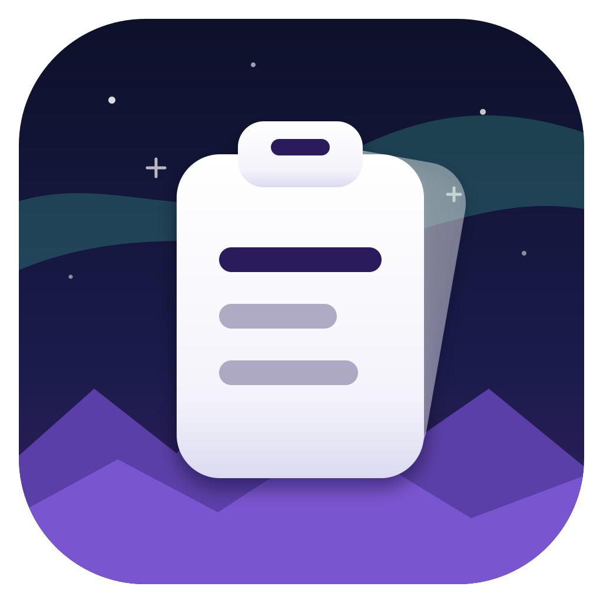
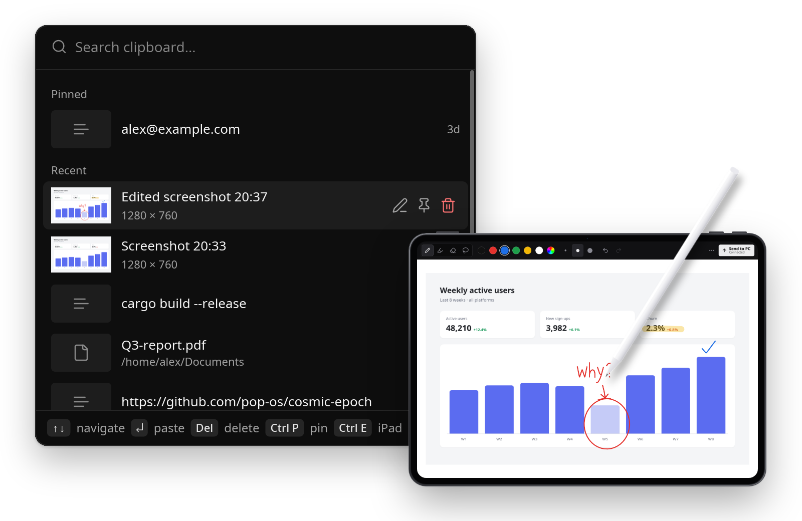

<p align="center">
  
</p>

<h1 align="center">Clipstack</h1>

<p align="center">
  <strong>Super+V clipboard history for the COSMIC desktop.</strong><br />
  Everything you copy, one shortcut away, plus your iPad as a drawing pad.
</p>

<p align="center">
  <a href="#installation"><strong>Install</strong></a> ·
  <a href="#drawing-on-the-ipad">iPad</a> ·
  <a href="LICENSE">License</a>
</p>

<a href="./.github/screenshot.png">
  
</a>

Clipstack runs in the background and keeps a history of what you copy. Press Super+V, pick an entry, and it is pasted where you were typing.

- **Opens where you work**, next to the text cursor or the mouse pointer.
- **Text, images and files**, with previews.
- **Search and pin** entries you need often.
- **Private**: everything stays on your machine, and passwords from password managers are never stored.
- **Draw on the iPad**: send an image to your iPad, annotate it with the Apple Pencil and get it back on the clipboard.

> [!NOTE]
> Clipstack is built for the COSMIC desktop (Wayland) and for iPad with Safari and Apple Pencil. Other desktops, browsers and tablets are untested and may not work.

## Installation

Download `Clipstack-x86_64.AppImage` from the [releases](https://github.com/j-gaertig/clipstack/releases) and start it once:

```bash
chmod +x Clipstack-x86_64.AppImage
./Clipstack-x86_64.AppImage
```

It sets up autostart and the Super+V shortcut, then runs in the background. To remove it again, run it with `--uninstall`.

## Drawing on the iPad

The iPad and the PC need to be on the same network.

1. Press Super+V, open the iPad panel (tablet icon or Ctrl+I) and scan the QR code.
2. Add the page to the Home Screen and enter the pairing code shown on the PC. This is needed only once.
3. Click the pen icon on an image in the history (or press Ctrl+E) to send it to the iPad.
4. Draw, then tap **Send to PC**. The result lands on the clipboard and in the history.

## License

MIT, see [LICENSE](LICENSE). Includes the [Inter](https://rsms.me/inter/) font (OFL) and [Lucide](https://lucide.dev) icons (ISC).
